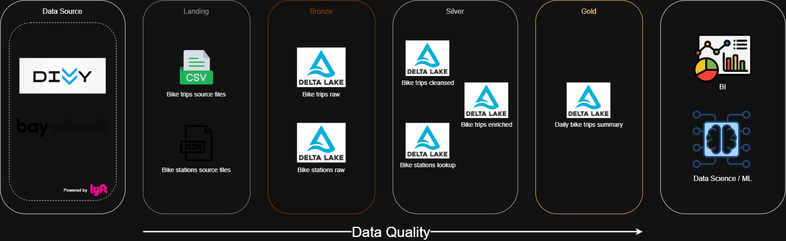
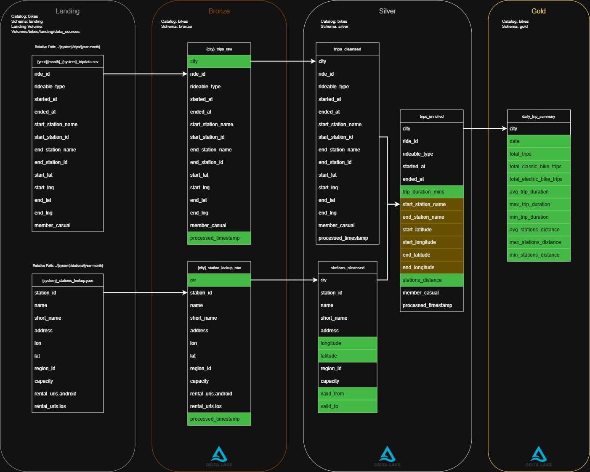
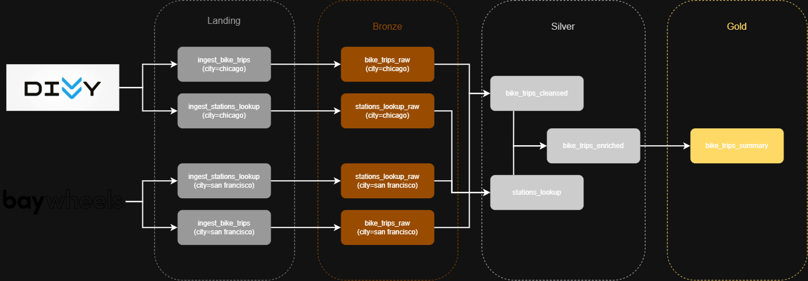

# Bike Trips Data Pipeline with Databricks

Which trips cover the longest distances? Which areas of the city are most popular among cyclists? At what time of day are bikes used the most? This project is a Databricks pipeline that provides different users with high-quality data on daily bike trips.

## Objective

Provide BI developers, data analysts and data scientists with clean, reliable data on bike trips, extracted and processed from the public bike-share systems of different cities.

## Solution

The pipeline extracts data from [Bay Wheels](https://lyftbikes.com/system-data) (San Francisco) and [Divvy](https://divvybikes.com/system-data) (Chicago), both operated by Lyft. Each system publishes open data on all the trips taken every month, along with real-time information about its bike stations.

### Architectural and Technical Decisions

- **Batch pipeline:** since each system publishes its data monthly, there is no need for streaming or event-driven processing. A job scheduled to run once a month is enough.
- **Medallion Architecture:** splitting the pipeline into layers improves maintainability, makes debugging easier, improves data quality step by step, and supports governance and scalability.
- **SCD Type 2:** bike station locations can change over time, so keeping the history of every station keeps the trip data accurate.
- **PySpark:** the monthly data volume does not exceed 1 GB, so a single-node library such as Pandas or Polars would be enough for this workload. PySpark was chosen to apply and demonstrate distributed processing skills, and it leaves the pipeline ready to scale as more cities are added.
- **Databricks:** provides an environment that fits naturally with the Medallion Architecture and comes with Apache Spark built in.
- **Delta Lake:** offers time travel, data versioning and efficient upserts. It also enforces schemas, which can be relaxed to accept new columns added to the data sources.

### Architecture

#### High-Level Architecture

1. **Landing and Bronze layers**
   - The landing layer downloads the monthly bike trips CSV and the bike stations snapshot JSON, and stores them in a volume.
   - The bronze layer reads those files and appends them to the raw Delta tables, adding only audit fields.
2. **Silver layer**
   - Merges the bike trips from all cities, discards trips without a start or end station, and appends them to the cleansed trips Delta table.
   - Merges the bike station snapshots from all cities and applies the SCD Type 2 process to track new and updated stations.
   - Joins trips and stations, calculates trip metrics, and appends the result to the enriched trips Delta table.
3. **Gold layer**
   - Aggregates the enriched trips by city and day, and appends them to the daily trip summary Delta table, ready for monthly reporting.



#### Data Architecture

See the full [Data Dictionary](./data_dictionary.md).



#### Low-Level Architecture

1. **ingest_bike_trips:** downloads the CSV with the bike trips of a specific month and city.
2. **ingest_stations_lookup:** downloads the JSON with the current snapshot of a city's bike stations.
3. **bike_trips_raw:** reads the month's CSV from the volume, adds the `city` and `processed_timestamp` audit columns, and appends it to the city's raw Delta table.
4. **stations_lookup_raw:** reads the month's JSON from the volume, adds the `city` and `processed_timestamp` audit columns, and appends it to the city's raw Delta table.
5. **bike_trips_cleansed:** reads the raw bike trips tables of all cities, merges them, and appends them to the cleansed trips Delta table.
6. **stations_lookup:** reads the raw station tables of all cities, merges them, renames `lon`/`lat` to `longitude`/`latitude`, and applies the SCD Type 2 process (`valid_from`/`valid_to`) to new and updated stations.
7. **bike_trips_enriched:** joins the month's bike trips with the stations, calculates `trip_duration_mins` and `stations_distance` (Haversine distance), and appends the result to the enriched trips Delta table.
8. **bike_trips_summary:** aggregates the month's enriched trips by `city` and `date`, calculates the daily metrics, and appends them to the daily trip summary Delta table.

> **Note:** pipeline tasks run with parameters defined in the [pipeline configuration](transformations/bikes_pipeline.yaml).



## Requirements

### Databricks

- Databricks workspace with **Unity Catalog** enabled (permissions to create catalogs, schemas and volumes)
- Databricks Runtime: 18 LTS
- Apache Spark: 4.1.0
- Delta Lake (included in the runtime)
- Languages: Python, SQL

### Local Development

- Python 3.12 or later (the notebooks use f-strings with nested quotes, a Python 3.12 feature)
- Java 17 or later (required by PySpark 4.x to run Spark locally)
- Git
- Python libraries listed in [requirements.txt](requirements.txt):

| Library | Version | Usage |
| --- | --- | --- |
| `pyspark` | 4.1.0 | DataFrame transformations in every layer |
| `delta-spark` | 4.1.0 | `DeltaTable` merges for the SCD Type 2 process |
| `requests` | >= 2.31 | Downloading trip and station files from the data sources |
| `python-dateutil` | >= 2.8 | Calculating the target month (`relativedelta`) |

> **Note:** these libraries are pre-installed in Databricks Runtime 18 LTS, so nothing needs to be installed on the cluster. The local environment is only for development.

## Installation and Setup

1. Clone the repository and create the Python environment:

   ```bash
   git clone https://github.com/SantoB20/databricks-bike-trips.git
   cd databricks-bike-trips
   python3 -m venv .venv
   source .venv/bin/activate  # Windows: .venv\Scripts\activate
   pip install -r requirements.txt
   ```

2. In Databricks, add the repository via **Workspace > Create > Git folder**.
3. Run [catalog_schemas_volume_setup](one_off/catalog_schemas_volume_setup.ipynb) once to create the `bikes` catalog, its schemas and the `data_sources` volume.
4. (Optional) Load historical data by running the [initial load](one_off/initial_load/notebooks) notebooks in layer order (`00_landing` → `03_gold`).
5. Replace `/path/to/bike-trips` in the [pipeline configuration](transformations/bikes_pipeline.yaml) with your Git folder path, then go to **Jobs & Pipelines > Create > Job > Edit as YAML**, paste it and save.

## Project Structure

```text
databricks-bike-trips/
├── ad_hoc/
│   └── pipeline_results_eda.ipynb
├── img/
│   ├── data_architecture.png
│   ├── high_level_diagram.png
│   └── low_level_diagram.png
├── modules/
│   ├── data/
│   │   ├── bulk_read.py
│   │   └── file_download.py
│   ├── transformation/
│   │   ├── geography.py
│   │   └── metadata.py
│   └── utils/
│       └── date.py
├── one_off/
│   ├── catalog_schemas_volume_setup.ipynb
│   └── initial_load/
│       └── notebooks/
│           ├── 00_landing/
│           │   ├── backfill_bike_stations.ipynb
│           │   └── backfill_historical_bike_trips.ipynb
│           ├── 01_bronze/
│           │   ├── bike_trips_raw.ipynb
│           │   └── stations_lookup_raw.ipynb
│           ├── 02_silver/
│           │   ├── bike_trips_cleansed.ipynb
│           │   ├── bike_trips_enriched.ipynb
│           │   └── stations_lookup.ipynb
│           └── 03_gold/
│               └── daily_trip_summary.ipynb
├── transformations/
│   ├── bikes_pipeline.yaml
│   └── notebooks/
│       ├── 00_landing/
│       │   ├── ingest_bike_trips.ipynb
│       │   └── ingest_stations_lookup.ipynb
│       ├── 01_bronze/
│       │   ├── bike_trips_raw.ipynb
│       │   └── stations_lookup_raw.ipynb
│       ├── 02_silver/
│       │   ├── bike_trips_cleansed.ipynb
│       │   ├── bike_trips_enriched.ipynb
│       │   └── stations_lookup.ipynb
│       └── 03_gold/
│           └── daily_trip_summary.ipynb
├── data_dictionary.md
├── requirements.txt
└── README.md
```

## Future Improvements

- Reflect San Francisco's rebranding from **Bay Wheels** to **Lyft Bike**.
- Add other US public bike-share systems, such as [Citi Bike](https://citibikenyc.com/system-data) (New York–New Jersey), [Capital Bikeshare](https://capitalbikeshare.com/system-data) (Washington, D.C.) and [Bluebikes](https://bluebikes.com/system-data) (Boston).
- Join bike trips data with pricing plans.
- Partition (or apply liquid clustering to) the trips tables by `city` and date, as the number of implemented cities grows.
- Join bike trips data with weather data to analyze how conditions affect demand.
- Add more Gold layer reports, such as most popular stations, frequent origin–destination routes and usage by hour of day.
- Add data quality validations with Lakeflow Declarative Pipelines (DLT) expectations.

## Contact Me

If you're passionate about technology, or if you're looking for a dedicated Systems Engineer, let's connect! Feel free to send me a message.

Santiago Burbano Puin | [LinkedIn](https://www.linkedin.com/in/santiago-burbano-puin/) | [santibur444@gmail.com](mailto:santibur444@gmail.com)
